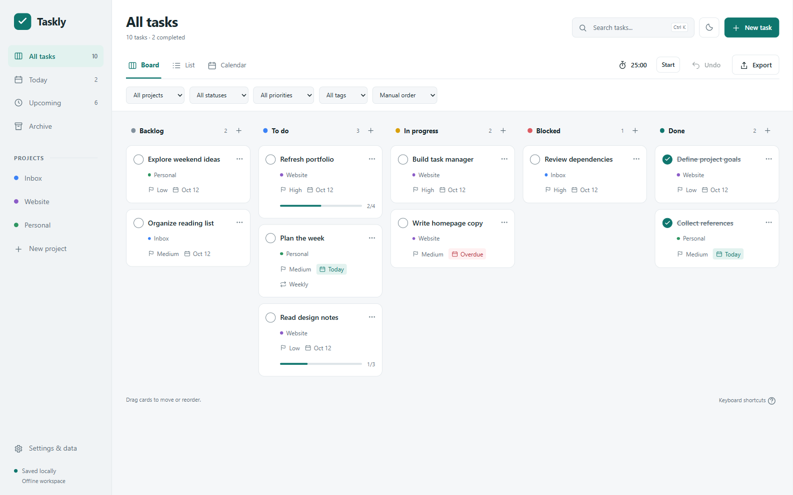

# Taskly

Download this repository with **Code → Download ZIP**, extract it, then double-click **Taskly.html** to open your task manager. Everything the app needs is embedded in that file; it works offline. No installation, server, or account is required. The other files in this folder are optional design records.

The app includes Board, List, and Calendar views, custom workflows, projects, search and filters, checklists, tags, priorities, recurring tasks, archive, undo, a focus timer, and light/dark themes. The preview uses example tasks; your workspace starts empty.

Use Board, List, or Calendar to manage work. Settings contains projects and workflow customization, JSON backup/restore, CSV export, clear-completed, and workspace reset. JSON preserves all tasks, archived history, preferences, and timer state.

Data saves in this browser on this device. For directly opened files, storage behavior varies by browser and file location. Export a JSON backup before moving the file, switching browsers, clearing browser data, or resetting your workspace. A failed save keeps your current work in memory; export it before closing the tab.

Right-click a task on the board, list, calendar, or agenda for actions. The three-dot button opens the same menu on touch devices. Use **Shift F10** on a focused task, arrow keys to navigate, and **Escape** to dismiss. Shift-right-click keeps the browser menu.

Shortcuts: **N** new task, **Ctrl/⌘ K** search, **Ctrl/⌘ Z** undo, **1 / 2 / 3** switch views, **?** shortcut help, **Ctrl/⌘ Enter** save task. Deadline dates use the device's local timezone. Repeating tasks create the next future occurrence when completed. The timer checks timestamps when the tab resumes and shows an in-app notice.

Verified in Chrome by directly opening the file, including an offline-emulated reload, persistent task changes, recurrence and undo, timer recovery, malformed and large backups, exports, storage failures, reset scope, keyboard controls, and responsive layouts. A 1,000-task fixture was also checked. Edge and assistive technology were not independently tested.

Design captures show synthetic example tasks. The delivered app starts empty.
